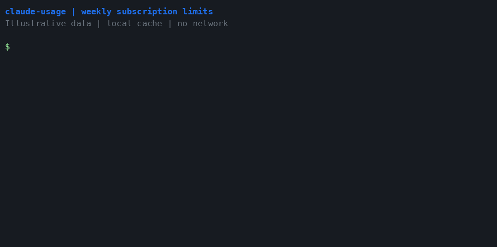

<h1 align="center">📊 claude-usage</h1>

<p align="center">
  <b>Your Claude subscription limits — right from your terminal.</b>
</p>

<p align="center">
  <a href="https://pypi.org/project/claude-usage-limits/"></a>
  
  
  
  
</p>

<p align="center">
  
</p>

---

Claude Code shows your subscription limits only in the interactive `/usage`
screen. **`claude-usage` gives you the weekly usage and model limits from the shell** — for
scripts, hooks, and AI agents deciding when to back off. It uses the Claude Code
login already on your machine. No API key to manage, nothing to configure.

**Install `claude-usage-limits` from PyPI; the command is `claude-usage`.**

```text
$ claude-usage
7-day: 59% used, resets Sun 03:00 (in 12h29m)
```

## ✨ Features

- **Weekly limits, one command** — 7-day usage, populated weekly variants, and local reset times.
- **🚦 Thresholds for scripts** — `--warn [N]` checks all weekly limits; `--warn-7d [N]` checks overall weekly usage. Both exit 1 at or above N%.
- **📊 Extra detail** — `--all` shows per-model limits, the active window, and the weekly surface split.
- **📟 Status line** — a compact model and usage line that also feeds the documented fallback source.
- **🧾 Plain, JSON, or short** — readable in a terminal and easy to use from scripts.
- **🌍 Cross-platform** — macOS, Linux, and Windows; Python 3.9+.
- **🔋 Zero dependencies** — pure Python standard library.
- **🔒 Local & private** — reads your existing login; no telemetry or third-party calls.

## 🚀 Quickstart

```bash
pip install claude-usage-limits
claude-usage
```

Sign in with `claude` on this machine first. Any running Claude Code session keeps
its access token fresh.

## 🧑‍💻 Usage

| Command | What it does |
|---|---|
| `claude-usage` | Weekly usage windows and their reset times |
| `claude-usage --json` | Usage JSON from whichever source answered, with retired session limits removed; alias for `--format json` |
| `claude-usage --warn [N]` | Exit 1 when any weekly window or weekly model limit reaches N% (default 70) |
| `claude-usage --warn-7d [N]` | Exit 1 at or above N% of the 7-day window (default 70) |
| `claude-usage --all` | Add per-limit details and weekly surface breakdown in plain format |
| `claude-usage --format {plain,json,short}` | Choose output format (default plain) |
| `claude-usage --statusline` | Read Claude Code status-line JSON on stdin, cache it, print one compact line (hidden from help) |
| `claude-usage -v`, `--verbose` | Print only credential and usage source notes to stderr |
| `claude-usage -V`, `--version` | Print the version |
| `claude-usage -h`, `--help` | Show help |

Flags combine: `claude-usage --format short --warn 70 --warn-7d 90`.
`--json` and `--format` set the same option; the last one wins. `--all` adds detail
only in plain format, keeping JSON machine-readable and short output on one line.

<details>
<summary><b>📊 Example: <code>--all</code></b></summary>

```text
7-day: 60% used, resets Sun 03:00 (in 12h11m)
kind             percent  severity   active  model        reset
------------------------------------------------------------------------------
weekly_all           60%  normal     active               resets Sun 03:00 (in 12h11m)
weekly_scoped         9%  normal             Fable        resets Sun 03:00 (in 12h11m)
Claude Code 96%, Cowork 4%, Chats 0%, Other 0%
```

Detail fields depend on the account and endpoint response. With a status-line
answer, this prints `(details not available from the status-line source)` instead.
</details>

## 🤖 Using it from scripts and agents

```bash
claude-usage --warn 70 || echo "back off"
claude-usage --warn 70 --warn-7d 90 --format short
claude-usage --json
```

The usual output is always printed. Exit codes: **0** for success, **1** when
either threshold trips or no source answers, **2** for an argument error.
The threshold is inclusive: `--warn` exits 1 at 70%, including exactly 70%.
Missing or null windows do not trigger warnings. `--warn` includes weekly model
caps in `limits[]`; `--warn-7d` checks only `seven_day`. Populated `seven_day_*`
usage windows appear in plain and short output and are checked by `--warn`.
JSON retains other fields from the source, but removes retired session limits
from both endpoint and status-line payloads, including older cached answers.
Weekly share indices are adjusted when obsolete detail entries are removed.

## 📟 Claude Code status line

Set `statusLine` in `~/.claude/settings.json` (merge this field into your existing
settings):

```json
{
  "statusLine": {"type": "command", "command": "claude-usage --statusline"}
}
```

Claude Code pipes its documented status JSON to the command on each repaint:

```text
Fable 5.1 · 7d 59%
```

Missing parts are omitted. This mode never looks up credentials or makes a network
call. It also writes `last-statusline.json`, feeding the documented fallback when
the endpoint is unavailable. Invalid input produces no output and exits 0.
`claude-usage --format short` gives the same compact format from the normal source
order; endpoint answers usually have no model, so show `7d 59%`.

## 🤔 How it works

Sources are tried in this order:

1. `last-usage.json` if less than **5 minutes** old.
2. One live `GET https://api.anthropic.com/api/oauth/usage`, saved on success.
3. `last-usage.json` if less than **60 minutes** old.
4. `last-statusline.json` if less than **60 minutes** old and it has `rate_limits`.

Both caches live in `~/.claude`, or `CLAUDE_CONFIG_DIR` when set. Cache writes are
atomic. Cached answers at least a minute old show their source and age, e.g.
`(from the endpoint, 3 min ago)`; status-line answers always show their age.
If every source fails, the distinct reasons appear once each on stderr.

The endpoint returns **HTTP 429 on back-to-back calls**, sometimes blocking for
minutes. Five-minute reuse avoids repeating requests; there are no retries or
polling, and the single request times out after 15 seconds.

<details>
<summary><b>🔍 Where credentials live (per OS)</b></summary>

Resolution is local-only, in this order:

1. `CLAUDE_CODE_OAUTH_TOKEN` environment override, used as-is.
2. macOS Keychain service **`Claude Code-credentials`**, read with
   `security find-generic-password -s "Claude Code-credentials" -w`.
3. The credentials file, including on macOS when the keychain is unavailable
   (for example, a locked keychain over SSH).

| OS | Credentials file |
|---|---|
| macOS / Linux | `~/.claude/.credentials.json` |
| Windows | `%USERPROFILE%\.claude\.credentials.json` |

`CLAUDE_CONFIG_DIR` changes the credentials file directory and both cache paths.
The token is `claudeAiOauth.accessToken`; `expiresAt` is milliseconds since epoch.
An expired token is refused: open `claude` so it refreshes.

For the protocol and a recipe to rebuild the tool, see
**[docs/HOW_THIS_WAS_BUILT.md](docs/HOW_THIS_WAS_BUILT.md)**.
</details>

## 🔒 Privacy & security

- Reads existing credentials only; **never refreshes or writes credentials**.
- Sends the token only to **`api.anthropic.com`**, with the usage request.
- Writes only the two local usage caches; never modifies Claude Code settings.
- Never prints secrets or headers, including with `-v`.
- **No telemetry. No third-party calls.**

## ⚠️ Good to know

- The OAuth usage endpoint is **undocumented and rate limited**; it may change or
  disappear. The documented status-line path is the fallback.
- Status-line `rate_limits` for subscription windows is **Pro/Max only**, appears
  after the first API response, and drops individual windows after they reset.
  It updates only while a Claude Code session is active and repainting.
- The observed endpoint response came from a Max account. Fields on other plans
  may differ; an API key is not a Claude Code OAuth login.
- Any running `claude` keeps the access token fresh. This tool deliberately does
  not implement the undocumented refresh flow.
- Use **`/feedback` in Claude Code** to ask Anthropic for an official
  `claude usage` command.

## 🛠️ Install options

```bash
pip install claude-usage-limits       # from PyPI
pipx install claude-usage-limits      # isolated command installation
pip install .                  # from a local clone
```

Requires Python 3.9+. **The PyPI distribution is `claude-usage-limits`; the command and
GitHub repo are `claude-usage`, and the import package is `claude_usage`.**
The PyPI names `claude-usage`, `claude-usage-cli`, and `claude-code-usage` belong to
unrelated projects.

## 🤝 Contributing

Issues and PRs are welcome. After installing the local project with `pip install -e .`,
run the tests with:

```bash
pip install pytest && pytest -q
```

Tests use temporary config directories and mocked HTTP; they never contact the
endpoint or read your real credentials.

## 📄 License

[MIT](LICENSE) — do whatever you like.
